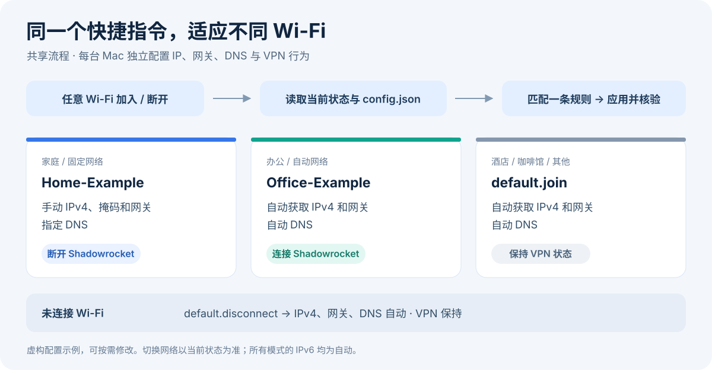

# macOS WiFi Switcher

在不同 Wi-Fi 之间切换时，自动应用本机的 IP、网关和 DNS 配置，并按需连接或断开 Shadowrocket VPN。一个快捷指令处理加入与断开事件，每台 Mac 使用独立配置。



## 适合哪些场景

| 场景 | 网络设置 | VPN 行为 |
| --- | --- | --- |
| 家中使用固定地址或自定义网关 | 手动 IPv4、掩码、网关和 DNS | 断开 Shadowrocket |
| 办公网络自动分配地址 | DHCP 和自动 DNS | 连接 Shadowrocket |
| 咖啡馆、酒店等其他网络 | DHCP 和自动 DNS | 保持当前状态 |
| 完全断开 Wi-Fi | 恢复自动网络配置 | 保持当前状态 |

表中的家庭与办公规则只是示例，均可修改。切换网络时按**当前连接状态**选择一条规则，不单独执行旧 Wi-Fi 的离开配置。

## 安装

需要 macOS 27、快捷指令和管理员授权；VPN 功能还需要已配置好的 Shadowrocket。当前在 macOS 27.0.1 核对界面及文件格式。源码生成使用 macOS 自带工具，不要求安装 Python。

1. 下载本仓库，阅读并修改 [config.example.json](config.example.json)。其中 SSID 和地址全部为虚构数据。
2. 按[安装指引](docs/INSTALL.md)创建本机配置、生成并导入快捷指令。
3. 添加“任何 Wi-Fi → 已加入或断开连接”触发条件，完成脚本及 VPN 授权后启用。

导入后不会自带自动化触发条件，便于先完成本机配置。也可根据[动作搭建表](docs/ACTIONS.md)手动搭建。

## 快捷指令截图

以下是开源模板在快捷指令中的真实界面，未执行网络切换。完整流程及变量关系见[流程说明](docs/WORKFLOW.md)。


## 配置示例

```json
{
  "version": 3,
  "networkService": "Wi-Fi",
  "default": {
    "join": { "mode": "auto", "shadowrocket": "keep" },
    "disconnect": { "mode": "auto", "shadowrocket": "keep" }
  },
  "networks": [
    {
      "ssid": "Home-Example",
      "join": {
        "mode": "manual",
        "ip": "192.0.2.20",
        "subnetMask": "255.255.255.0",
        "router": "192.0.2.1",
        "dns": ["192.0.2.1"],
        "shadowrocket": "disconnect"
      }
    },
    {
      "ssid": "Office-Example",
      "join": { "mode": "auto", "shadowrocket": "connect" }
    }
  ]
}
```

`192.0.2.0/24` 是文档示例网段，必须换成自己的实际地址。固定 IP 应由路由器保留，或避开 DHCP 地址池。

| 字段 | 含义 |
| --- | --- |
| `networkService` | macOS 的网络服务名，通常为 `Wi-Fi`，不是 SSID |
| `default.join` | 未匹配任何 SSID 时的完整配置 |
| `default.disconnect` | 未连接 Wi-Fi 时的全局规则；只允许 `auto + keep` |
| `networks[].ssid` | 精确匹配且区分大小写，不能重复 |
| `networks[].join` | 命中该 Wi-Fi 时的完整配置，不逐字段继承 `default.join` |
| `mode` | `auto` 自动获取 IPv4、网关和 DNS；`manual` 使用指定值 |
| `shadowrocket` | `keep` 保持、`connect` 连接、`disconnect` 断开 |

`manual` 必须填写 `ip`、`subnetMask`、`router` 和非空 `dns` 数组，目前仅支持 IPv4 地址。两种模式都会把 IPv6 设为自动。每个 Wi-Fi 仅支持 `join`，不支持单独的 `disconnect`。JSON 不支持行内注释，示例中的 `_comment` 是供阅读的普通字段。

## 源码与边界

- [shell/](shell/)：七个内联 Shell 动作的源码。
- [shortcut/workflow.json](shortcut/workflow.json)：可审查的原生动作结构与变量连接，脚本内容在构建时注入。
- [流程说明](docs/WORKFLOW.md)：状态选择、任务编号、文件锁、输出与限制。
- [离线检查](tests/test_offline.py)：使用临时文件和模拟网络命令，不改动实际网络或 VPN。

运行时只在配置目录创建 `current-run` 和 `apply.lock`。它们由脚本管理，无需手动建立或跨机器同步。本机 `config.json`、运行文件及签名产物均已加入忽略规则；仓库不提供个人快捷指令分享链接。

网络设置写入与最终核验已做隔离模拟。真实切换请在可接受短暂断网时自行验证。设置核验不等于 IP 冲突检测；任务取消也无法撤销已经开始的系统命令或原生 VPN 动作。

## 开发检查

```sh
sh tools/build.sh
python3 -m unittest discover -s tests -v
```

这些命令不会运行快捷指令或改动网络。截图中的第三方应用界面与商标归其各自权利人所有；项目源码采用 [MIT License](LICENSE)。
