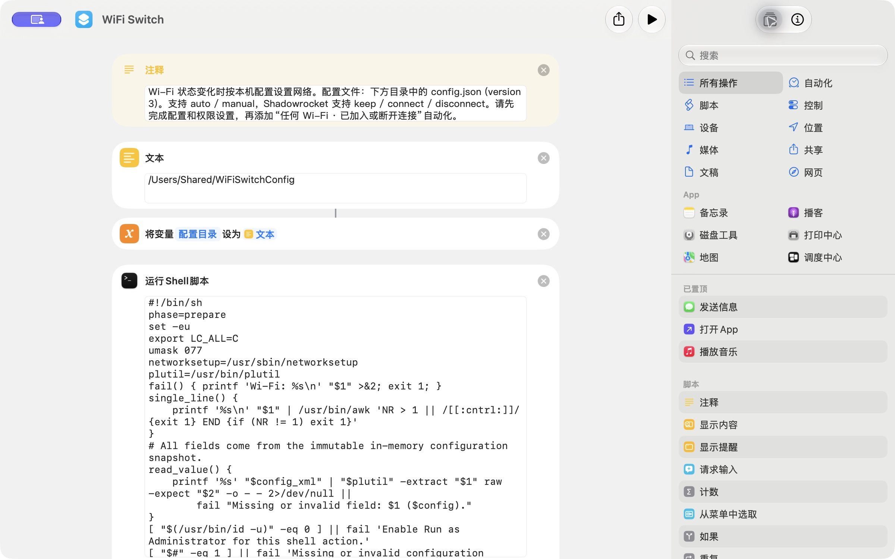

# 手动搭建快捷指令

在快捷指令中新建 **WiFi Switch**，依次添加下表动作。此方式不使用分享链接或签名服务。先完成[本机配置](INSTALL.md#2-下载源码并创建配置)，最后再添加自动化触发条件。

表中的 `#5` 表示**第 5 行动作的输出魔法变量**，不是要输入的文本。同名“文本”很多，选择魔法变量时务必回到对应动作。列表中的两个值分别放在两项里，不要合并成一段文字。

所有 Shell 动作统一设置为：**Shell `/bin/sh` → 作为参数 → 以管理员身份运行**。打开对应源码文件，将全文粘贴到动作中；不要仅填写文件路径。添加“如果”和“重复”时，快捷指令会自动生成“否则”“结束如果”“结束重复”，按表格安排嵌套层级即可。

| # | 动作 | 参数 / 输入 |
| --- | --- | --- |
| 1 | 注释 | 可填写用途与配置说明，不影响执行 |
| 2 | 文本 | `/Users/Shared/WiFiSwitchConfig` |
| 3 | 设定变量 | 名称“配置目录”，值为 #2 |
| 4 | 运行 Shell 脚本 | [prepare.sh](../shell/prepare.sh)，输入“配置目录” |
| 5 | 从输入获取文本 | #4 |
| 6 | 重复 | 3 次，开始循环 |
| 7 | 列表 | 两项：#5、内置变量“重复索引” |
| 8 | 运行 Shell 脚本 | [probe-first.sh](../shell/probe-first.sh)，输入 #7 |
| 9 | 从输入获取文本 | #8 |
| 10 | 如果 | #9 **是** `STALE` |
| 11 | 停止执行此快捷指令 | 在 #10 内 |
| 12 | 结束如果 | 结束 #10；删除其空的“否则” |
| 13 | 如果 | #9 **是** `CONNECTED` |
| 14 | 获取网络详细信息 | **Wi-Fi → 网络名称**，在 #13 内 |
| 15 | 否则 | 对应 #13 |
| 16 | 无 | 在 #15 内，输出空值 |
| 17 | 结束如果 | 结束 #13，保留“如果结果”供下一步使用 |
| 18 | 列表 | 两项：#5、#17 的“如果结果” |
| 19 | 运行 Shell 脚本 | [apply.sh](../shell/apply.sh)，输入 #18 |
| 20 | 从输入获取文本 | #19 |
| 21 | 如果 | #20 **是** `STALE` |
| 22 | 停止执行此快捷指令 | 在 #21 内 |
| 23 | 结束如果 | 结束 #21；删除其空的“否则” |
| 24 | 运行 Shell 脚本 | [probe.sh](../shell/probe.sh)，输入 #20 |
| 25 | 从输入获取文本 | #24 |
| 26 | 如果 | #25 **是** `CONNECTED` |
| 27 | 获取网络详细信息 | **Wi-Fi → 网络名称**，在 #26 内 |
| 28 | 否则 | 对应 #26 |
| 29 | 无 | 在 #28 内，输出空值 |
| 30 | 结束如果 | 结束 #26，保留“如果结果”供下一步使用 |
| 31 | 列表 | 两项：#20、#30 的“如果结果” |
| 32 | 运行 Shell 脚本 | [verify.sh](../shell/verify.sh)，输入 #31 |
| 33 | 从输入获取文本 | #32 |
| 34 | 如果 | #33 **是** `RETRY`，此分支留空 |
| 35 | 否则 | 对应 #34；以下 #36–47 均在此分支内 |
| 36 | 如果 | #33 **是** `APPLY_SHADOWROCKET` |
| 37 | 运行 Shell 脚本 | [vpn-gate.sh](../shell/vpn-gate.sh)，输入 **#20**，在 #36 内 |
| 38 | 从输入获取文本 | #37 |
| 39 | 如果 | #38 **是** `DISCONNECT_SHADOWROCKET` |
| 40 | Shadowrocket：断开 VPN | 在 #39 内 |
| 41 | 否则 | 对应 #39 |
| 42 | 如果 | #38 **是** `CONNECT_SHADOWROCKET`，在 #41 内 |
| 43 | Shadowrocket：连接 VPN | 在 #42 内 |
| 44 | 结束如果 | 结束 #42；删除其空的“否则” |
| 45 | 结束如果 | 结束 #39 |
| 46 | 结束如果 | 结束 #36；删除其空的“否则” |
| 47 | 停止执行此快捷指令 | 在 #35 内、#36 外 |
| 48 | 结束如果 | 结束 #34 |
| 49 | 结束重复 | 结束 #6 |
| 50 | 运行 Shell 脚本 | [final-error.sh](../shell/final-error.sh)，输入 #5，在循环外 |

两个 SSID 分支中的“无”用来保证断开时输出空值，应当保留。`RETRY` 分支留空即可，不需要“无”或额外等待；等待已经由下一轮的 `probe-first.sh` 处理。

`vpn-gate.sh` 的输入是 #20 的**目标记录**，不是 #33 的 `APPLY_SHADOWROCKET` 文本。#47 必须在循环内部，用于成功或过期任务退出；只有耗尽三轮仍未成功才会执行 #50。

完成后按[安装指引第 4–6 步](INSTALL.md#4-核对目录与权限)设置权限、添加统一的 Wi-Fi 自动化，并在可接受断网时自行测试。
