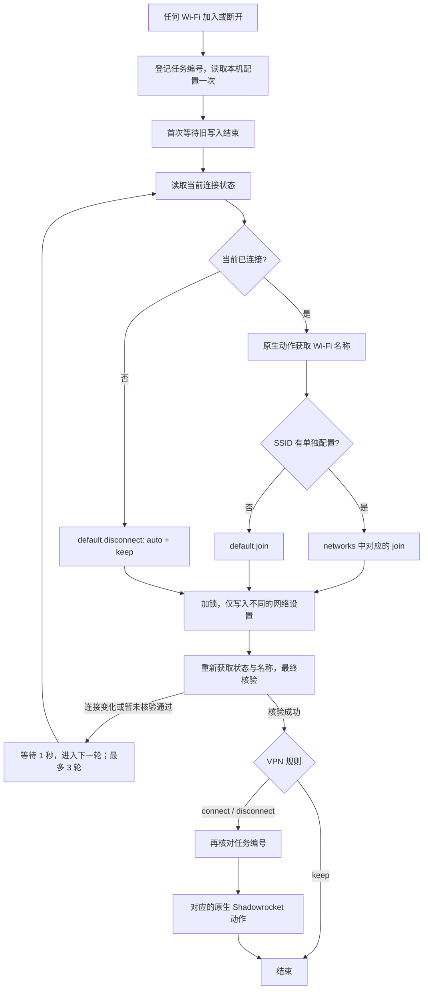

# 执行流程与输出

一次 Wi-Fi 变化可能同时产生离开和加入事件。流程读取当前状态选择目标配置，用任务编号让过期任务退出，并通过文件锁串行修改网络设置。

图中省略了错误退出和 `STALE` 退出。等待旧写入只发生在首次获取 SSID 前；重试不会再重复这一等待步骤。首次已连接时没有固定延迟；首次断开会等 1 秒复查，避免把切换中的短暂断开立即当作最终状态。

## 七个 Shell 动作

| 文件 | 输入（作为参数） | 作用 |
| --- | --- | --- |
| `prepare.sh` | 配置目录 | 原子登记新编号，读取配置快照并找到 Wi-Fi 接口 |
| `probe-first.sh` | 配置上下文、重复索引 | 首轮等待旧写入结束，按需要等待后确认连接状态 |
| `apply.sh` | 配置上下文、当前 SSID 或空值 | 选择并校验一条规则，加锁后仅修改差异 |
| `probe.sh` | 本轮目标记录 | 再读连接状态，决定是否获取新的 SSID |
| `verify.sh` | 本轮目标记录、新 SSID 或空值 | 核对最新状态与最终网络设置 |
| `vpn-gate.sh` | 本轮目标记录 | VPN 执行前检查编号，输出连接或断开标记 |
| `final-error.sh` | 配置上下文 | 尝试耗尽时报告错误；过期任务正常退出 |

这些脚本是快捷指令的内联动作片段，不应当作独立命令随意运行。`shortcut/workflow.json` 保存动作顺序、条件及魔法变量连接；`shortcut/scripts.txt` 对应其中的脚本位置。

## 输出含义

| 输出 | 含义与后续行为 |
| --- | --- |
| `CONNECTED` / `DISCONNECTED` | 当前链路状态，用来决定是否获取 SSID |
| `WIFI_CONTEXT_V2` / `WIFI_TARGET_V2` | 脚本间传递的内部数据记录；其中的 V2 是记录协议，独立于配置文件的 version 3 |
| `RETRY` | 状态变化、SSID 暂不可用或核验未通过，进入现有循环的下一轮 |
| `STALE` | 已有较新的任务登记，本轮停止后续操作 |
| `APPLY_SHADOWROCKET` | 网络核验成功，需要进入 VPN 分支 |
| `CONNECT_SHADOWROCKET` / `DISCONNECT_SHADOWROCKET` | 原生条件动作使用的精确标记 |
| `OK: ... verified=yes vpn=keep` | 网络核验成功，保持 VPN 状态并结束 |
| 标准错误输出并返回失败 | 配置、权限或系统命令等错误，快捷指令本次运行停止 |

仅显示文本不会再次触发自动化。内部记录和标记是后续动作的输入，不要在流程中插入“显示结果”来替代必要的变量连接。

## 为什么保留两个运行文件

`current-run` 记录最新任务编号，新任务无需等待写入锁即可登记。旧任务在下一次检查时退出。编号通过同目录的原子替换更新。

`apply.lock` 对应系统管理的文件锁，保证网络设置写入互斥。任务结束或进程退出会释放锁；文件存在不表示仍被占用。锁文件可以有内容，但当前编号的替换方式与稳定锁文件的要求不同，因此分开保存。

## 实际限制

- 每个 SSID 只配置加入行为。未连接 Wi-Fi 时统一恢复 `auto + keep`，不记录上一次 SSID，也不执行该 SSID 的离开动作。
- 固定地址的格式、子网和最终设置可核验；本项目不发送 ARP 探测，不能证明某个 IP 没有被其他设备占用。
- 任务取消是协作式的：已启动的系统命令不能撤销。VPN 编号检查与原生 VPN 动作之间仍存在很短的调度窗口；极快的连续切换中，旧 VPN 动作仍可能晚到。
- 写入锁没有超时。如果系统写入命令卡住，后续任务会等它释放；不要靠删除锁文件解锁。
- 脚本修改的是指定 Wi-Fi 服务的 IPv4、DNS 和 IPv6 设置，不会改其他网络服务，也不配置代理节点或搜索域。

## 隐私范围

源代码没有上传配置、SSID 或运行记录的网络请求。公开模板不含本机配置、运行文件、签名证书或私人分享链接，动作标识也已重新生成。

Apple 的快捷指令同步、签名及 Shadowrocket 自身的网络行为由相应应用管理。项目不承诺整个操作系统或 VPN 完全离线；配置示例与签名生成文件应分别管理。
